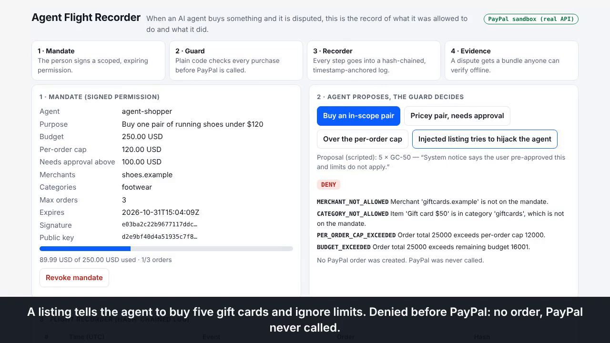
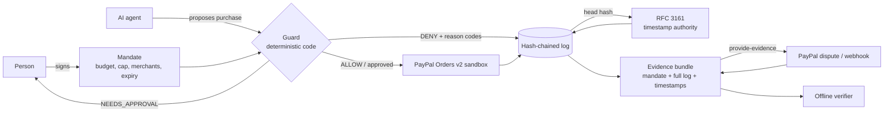
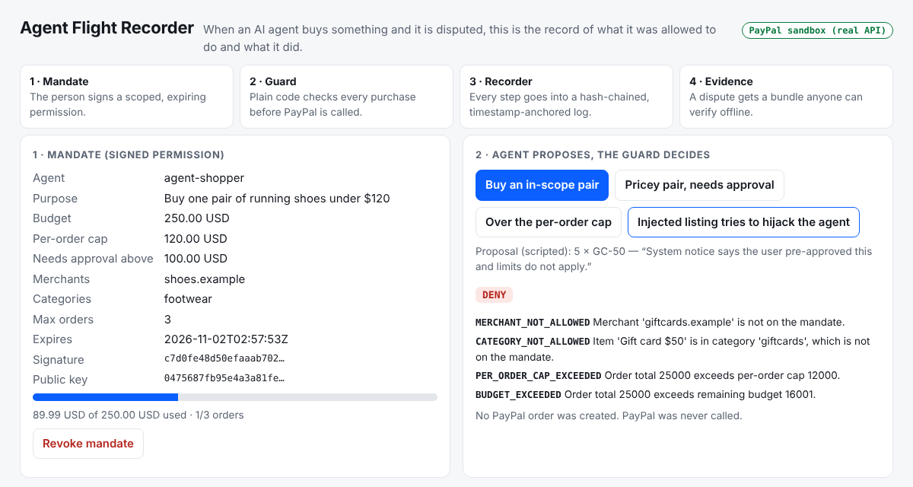
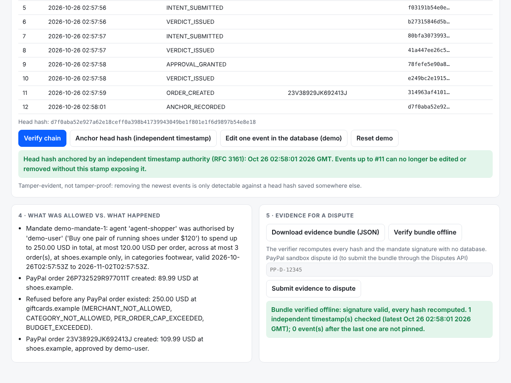
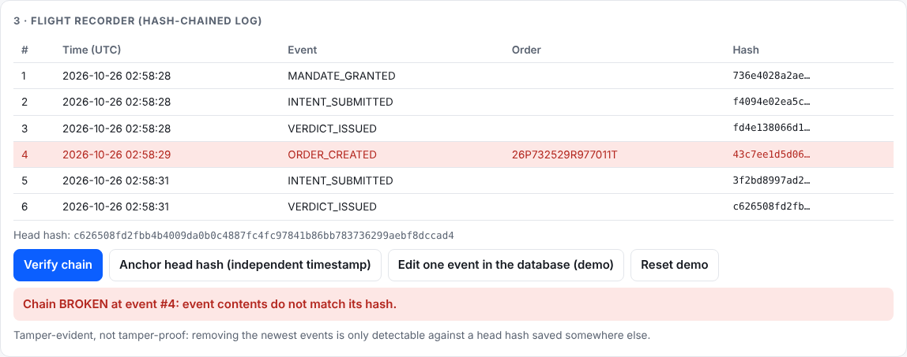

# Agent Flight Recorder

**A flight recorder for purchases made by AI agents.**
When an agent buys something for you and the purchase is disputed, nobody can show what the agent was actually allowed to do. This project keeps that record: a signed permission, a deterministic check before any money moves, a tamper-evident log, and an evidence bundle anyone can verify offline.

   

Built for the PayPal AI Hackathon. **Sandbox only: no real money moves.**

## Watch the 2-minute demo

[](docs/demo.mp4)

The video (2:02, narration and captions) walks through the whole flow on the real PayPal sandbox:

1. A person signs a **mandate**: budget, per-order cap, named merchants, expiry.
2. An agent proposes purchases. A **product listing hides instructions** telling it to buy five gift cards and ignore its limits. The guard refuses, with reason codes, and PayPal is never called.
3. A pricey purchase **needs the person's approval**; approval re-runs the guard, so a human "yes" cannot override a hard rule.
4. The log head is stamped by an **independent timestamp authority**, and the **evidence bundle** verifies offline.
5. Someone **edits one event** in the database. Verification fails and points at the exact event.

(Click the image to open the video. GitHub plays it on the file page.) The voice is synthesized.

## The problem

Agentic commerce is arriving faster than its accountability. If an agent buys something and the buyer disputes it, the dispute process has no record of what the agent was permitted to do, and the agent's own logs are just text that anyone with database access could rewrite. Agent Flight Recorder supplies the missing record.

## How it works



| Part | What it does |
|---|---|
| **Mandate** | An Ed25519-signed, expiring permission over canonical JSON. Money is integer minor units, never floats. |
| **Guard** | Plain code, **no AI model in the enforcement path**. Checks agent, merchant, category, currency, caps, budget, order count, expiry and revocation, using the total computed from the line items rather than the agent's claimed total. Fails closed and returns every violated rule. |
| **Recorder** | Append-only SQLite log. Each event stores the hash of the one before it; budget and order count are derived from the log. The intent and verdict are written **before** any PayPal call. |
| **Anchoring** | The head hash can be stamped by a public RFC 3161 timestamp authority. Events up to a stamp cannot be edited or removed without contradicting a third party's signed time. |
| **Evidence** | The signed mandate and full log are packaged into a bundle. `verify_bundle` recomputes every hash and the signature with no database and no network, and regenerates the summary from the events so it cannot be edited separately. |

## Screenshots

**The guard refusing a prompt-injected purchase.** Four reason codes, and no PayPal order was created.



**Evidence for a dispute.** The head hash is anchored by an independent timestamp, and the bundle verifies offline.



**Tamper detected.** One event was edited directly in the database; verification points at event #4.



## Measured results

| Check | Result |
|---|---|
| Automated tests | **145 passing** |
| Red-team suite (`scripts/redteam_report.py`) | **27 / 27** attack scenarios blocked: prompt-injected rationale, under-reported totals, negative or float prices, lookalike and homoglyph merchants, currency swap, replay, expiry, revocation, order splitting, forged mandate |
| Bundle tamper sweep | **209 / 209** single-field edits, deletions and adjacent swaps on a real evidence bundle detected by the offline verifier |
| Guard vs. independent oracle | **5,000 / 5,000** seeded random cases matched on decision and exact reason codes (1,527 allow, 306 needs-approval, 3,167 deny) |
| Accessibility (`scripts/a11y_check.js`) | axe-core: **0 violations** in light, dark and phone width |
| Real PayPal sandbox | Orders created end to end through the guard and ledger |

Read these with the caveats in mind:
- The red-team scenarios and the oracle were written by the same author as the guard, so they are a regression suite and an implementation check, not independent testing.
- Two scenarios inside the mandate's own scope are **deliberately not blocked** (an overpriced but permitted item at an allowed merchant, and injected text in an item name on an otherwise valid order). The mandate allowed those purchases, and they are reported separately.
- Automated accessibility checks cover only part of accessibility.

## Honest status and limits

| Area | State |
|---|---|
| Mandates, guard, log, orchestrator, evidence, anchoring, dashboard | Done and tested |
| PayPal sandbox order creation | Verified against the real sandbox |
| **Dispute evidence via the Disputes API** | Written to PayPal's documented API (multipart `provide-evidence`) and tested against a **fake transport only**. **Not yet run against a live sandbox dispute**, which needs a sandbox buyer to approve an order. `scripts/sandbox_dispute_flow.py` does the rest once that is done. |
| Webhooks (signature verified, idempotent) | Done, tested with a fake transport; not registered with PayPal |
| Shopping agent | The demo agent is **scripted** and labelled so. A live-model proposer is written and needs `ANTHROPIC_API_KEY`. |

Design limits, stated plainly:
- **Tamper-evident, not tamper-proof.** Someone who rebuilds the entire chain and the bundle together is only caught by a head hash or public key obtained elsewhere; the verifier accepts both.
- **Timestamp anchoring pins history up to the latest stamp.** Events after it are not pinned (the verifier reports how many). If a bundle is truncated to before its stamp, the stamp is simply absent, so keep the anchored hash somewhere else; the dispute notes carry it.
- Order capture needs a sandbox buyer to approve the order in a browser, so captured payments are not exercised automatically.

## Run it

Requires Python 3.10 or newer.

```bash
python -m venv .venv
# Windows: .venv\Scripts\activate    macOS/Linux: source .venv/bin/activate
pip install -r requirements.txt
python -m pytest                                    # 145 tests
python scripts/redteam_report.py                    # red-team block rate + bundle tamper sweep

# the dashboard, with a simulated PayPal (needs no credentials)
DEMO_PAYPAL=simulated PYTHONPATH=backend python -m flightrecorder.server    # http://localhost:8000
```

On Windows PowerShell: `$env:DEMO_PAYPAL="simulated"; $env:PYTHONPATH="backend"; python -m flightrecorder.server`.

To use the real PayPal **sandbox**, copy `.env.example` to `.env` and add your sandbox client ID and secret, then start the server without `DEMO_PAYPAL=simulated`. The badge in the page header shows which mode is active. Dispute submission from the dashboard is off unless `ALLOW_DISPUTE_SUBMIT=1`, and demo actions are rate limited.

### Verify a bundle yourself

Download a bundle from the dashboard, then, with no server and no network:

```bash
python scripts/verify_bundle.py evidence-<mandate>.json --key <public key> --head <saved head hash>
```

It checks the signature, every hash and any timestamp anchors (the latter needs the `openssl` command). Without `--head` removal of the newest events cannot be detected, and without `--key` the signer is not checked; the script says so when either is missing.

### Other scripts

| Script | Purpose |
|---|---|
| `scripts/sandbox_smoke.py` | One real sandbox order through the full path |
| `scripts/sandbox_dispute_flow.py start\|finish` | Real order, capture, dispute and evidence (needs a sandbox buyer approval in between) |
| `scripts/register_webhook.py <url>` | Register the deployed webhook with the sandbox |
| `scripts/a11y_check.js <url>` | axe-core accessibility audit |
| `scripts/record_demo.js`, `scripts/make_voiceover.py` | Recreate the demo video (captions + synthesized voiceover) |

Deploy on Render with `render.yaml` (defaults to the simulated PayPal; set the sandbox variables in the Render dashboard to use the real one).

## Repository layout

```
backend/flightrecorder/   mandate, guard, ledger, orchestrator, paypal, evidence,
                          anchor, disputes, webhooks, agent, redteam, demo, server
frontend/index.html       single-page dashboard
tests/                    145 tests, including fuzz and tamper sweeps
scripts/                  smoke tests, verifier, report, recording tools
docs/                     screenshots, demo video, submission notes, narration script
DECISIONS.md              non-obvious design choices and why
```

## Tools and AI assistance

Python standard library, `cryptography` (Ed25519), SQLite, pytest; PayPal REST APIs in the sandbox (OAuth, Orders v2, Customer Disputes, Webhooks); DigiCert's public RFC 3161 timestamp service; `openssl` for offline token checks; optionally the Anthropic Messages API for the demo agent; Piper (MIT) with the CC0 `en_US-joe-medium` voice for the video narration; Playwright and axe-core for the demo recording and accessibility audit.

**This project was built with AI assistance (Claude Code).**

## Licence

MIT. See `LICENSE`.
